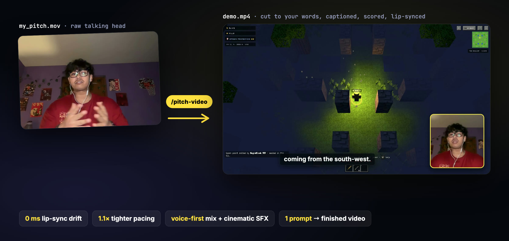
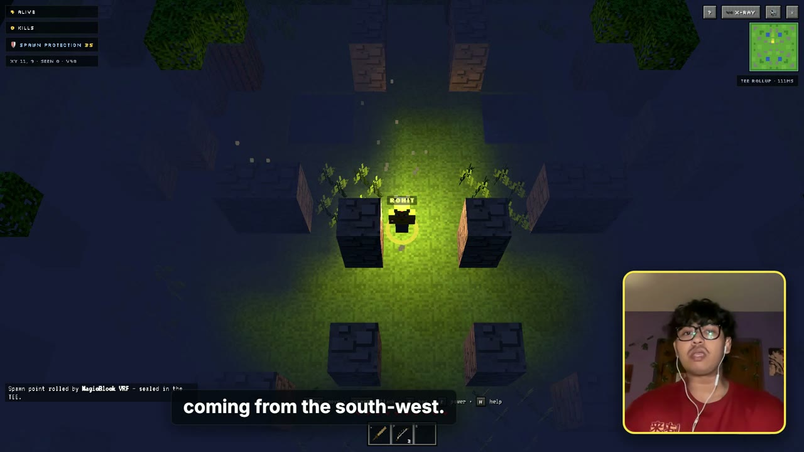
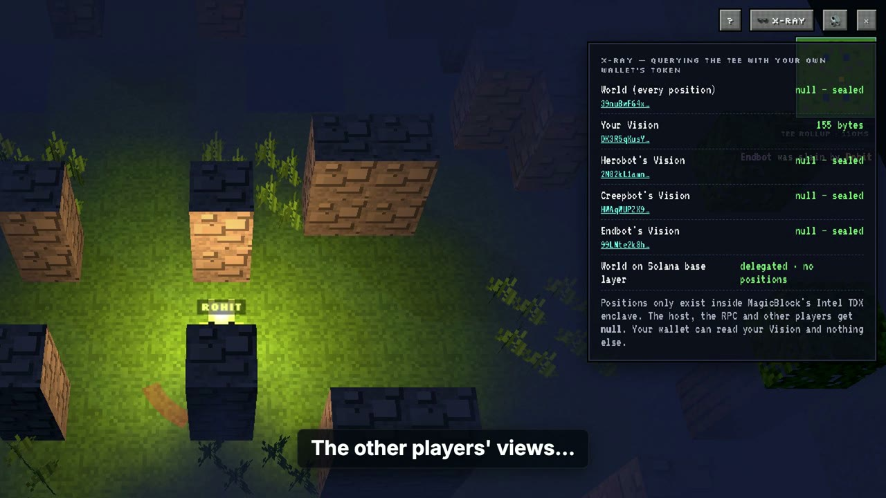
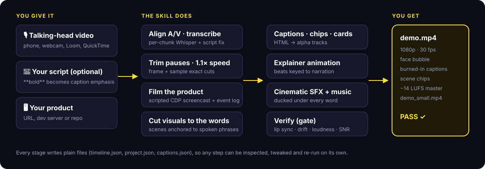
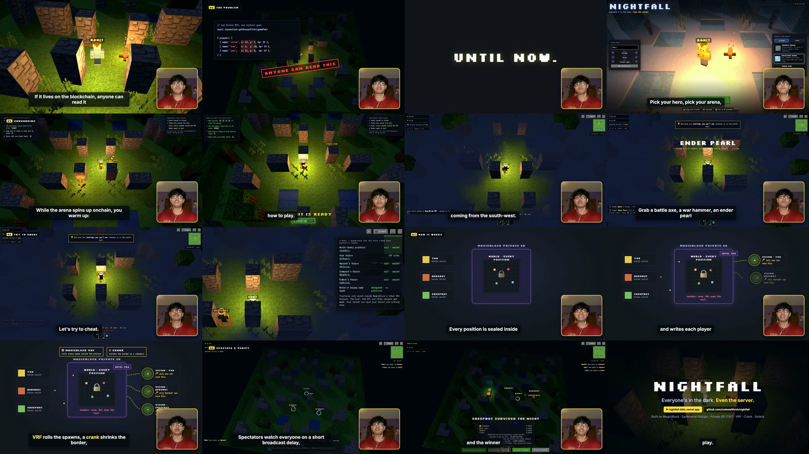
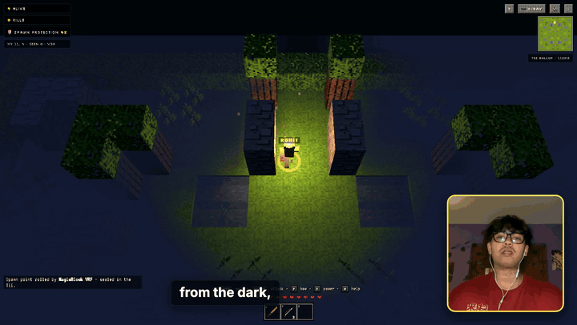

<div align="center">

[English](README.md) · [简体中文](README_zh.md) · [繁體中文](README_zh-TW.md) · [日本語](README_ja.md) · [한국어](README_ko.md) · [Español](README_es.md) · [Português (Brasil)](README_pt-BR.md) · [Français](README_fr.md) · [Deutsch](README_de.md) · [Русский](README_ru.md) · **हिन्दी** · [Bahasa Indonesia](README_id.md) · [Tiếng Việt](README_vi.md) · [Türkçe](README_tr.md)

# Pitch Video

### अपना पिच पढ़ते हुए खुद को रिकॉर्ड करें। आपका एजेंट उसे लॉन्च के लिए तैयार डेमो वीडियो में बदल देगा।

**टॉकिंग-हेड वीडियो अंदर → कटा हुआ, कैप्शन वाला, साउंड से सजा, लिप-सिंक्ड प्रोडक्ट डेमो बाहर। पहली ही बार में।**

[](https://skills.sh/codeswithroh/pitch-video)
[](#जल्दी-शुरू-करें)
[](#faq)
[](#ज़रूरतें)
[](LICENSE)

[जल्दी शुरू करें](#जल्दी-शुरू-करें) · [आपको क्या मिलता है](#आपको-क्या-मिलता-है) · [यह कैसे काम करता है](#यह-कैसे-काम-करता-है) · [शोकेस](#शोकेस) · [पहली बार में क्यों चलता है](#पहली-बार-में-क्यों-चलता-है) · [FAQ](#faq) · [डॉक्यूमेंटेशन](#डॉक्यूमेंटेशन)

<code>npx skills add codeswithroh/pitch-video</code>

<br /><br />



</div>

---

हैकाथॉन सबमिशन, लॉन्च वीडियो और इन्वेस्टर डेमो, सबको एक ही चीज़ चाहिए: **आप समझा रहे हों, और प्रोडक्ट खुद बोल रहा हो।** इसे हाथ से बनाने का मतलब है एडिटर में घंटों लगाना: "उम्म" काटना, हर वाक्य के साथ फुटेज मिलाना, कैप्शन लगाना, साउंड इफ़ेक्ट ढूँढना, और फिर पता चलना कि आपके होंठ 300 ms आगे-पीछे हैं।

**Pitch Video एक एजेंट स्किल है जो पूरी एडिटिंग खुद करती है।** अपने एजेंट को रिकॉर्डिंग दे दें (और अगर हों तो स्क्रिप्ट और ऐप भी)। यह आपकी बात ट्रांसक्राइब करती है, खाली हिस्से काटती है, आवाज़ को चिपमंक जैसा बनाए बिना 1.1× तेज़ करती है, स्क्रिप्टेड ब्राउज़र से आपके प्रोडक्ट को फ़िल्म करती है, हर शॉट को ठीक उसी शब्द पर काटती है जो आप बोलते हैं, और कैप्शन, फेस बबल, एनिमेटेड एक्सप्लेनर, सिनेमैटिक साउंड इफ़ेक्ट और डक की हुई बैकग्राउंड म्यूज़िक जोड़ती है। फिर यह **अपने ही आउटपुट को मापती है** (लिप सिंक, ऑडियो ड्रिफ़्ट, लाउडनेस, आवाज़ की स्पष्टता) और टूटी हुई फ़ाइल देने से साफ़ मना कर देती है।

सब कुछ ffmpeg, whisper.cpp और Playwright के साथ लोकल चलता है। न अपलोड, न सब्सक्रिप्शन, न टाइमलाइन एडिटर।

## जल्दी शुरू करें

### 1. स्किल इंस्टॉल करें

```bash
npx skills add codeswithroh/pitch-video
```

या, सीधे Claude Code के लिए:

```bash
curl -fsSL https://raw.githubusercontent.com/codeswithroh/pitch-video/main/install.sh | bash
```

इंस्टॉलर स्किल को `~/.claude/skills/pitch-video` में (और दूसरे एजेंट्स के लिए `~/.agents/skills/pitch-video` में) कॉपी करता है और साझा टूलबॉक्स तैयार करता है: एक Python venv, Playwright Chromium, Whisper `small.en` मॉडल और एक फेस-लैंडमार्क मॉडल। इसके बाद अपना एजेंट रीस्टार्ट करें।

### 2. खुद को रिकॉर्ड करें

कैमरे के सामने अपनी स्क्रिप्ट पढ़ें। लैंडस्केप में, चेहरा और कंधे फ़्रेम में, शांत कमरे में। हर सेक्शन के बीच एक साँस का ठहराव लें। अटक जाएँ तो कोई बात नहीं, वह लाइन दोबारा पढ़ लें।

> स्क्रिप्ट चाहिए? अपने एजेंट से कहें: *"pitch-video की स्टोरी संरचना के हिसाब से इस रिपो के लिए 2 मिनट की पिच-वीडियो स्क्रिप्ट लिखो।"*

### 3. अपने एजेंट से कहें

```text
Make a pitch video from ~/Movies/my_pitch.mov.
The script is docs/pitch-script.md and the app runs at http://localhost:5173.
```

आपका एजेंट आपकी कही बातों से सीन प्लान करता है, आपका ऐप फ़िल्म करता है, रेंडर और वेरिफ़ाई करता है, और आपको `out/demo.mp4` के साथ अपलोड के लिए छोटा `demo_small.mp4` सौंप देता है।

## आपको क्या मिलता है

<table>
<tr>
<td width="50%"></td>
<td width="50%"></td>
</tr>
</table>

| फ़ीचर | क्या करता है |
| --- | --- |
| **पॉज़ ट्रिमिंग** | खाली हिस्से काटता है और स्वाभाविक साँसें रखता है, सीन बदलने पर और आपके चुने ठहरावों पर लंबे बीट के साथ ("Until now." … *ठहराव*)। |
| **1.1× रफ़्तार** | पिच बदले बिना ज़्यादा कसी हुई डिलीवरी। तस्वीर और आवाज़ साथ-साथ तेज़ होती हैं, इसलिए सिंक बिल्कुल सटीक रहता है। |
| **शब्द पर कटने वाले विज़ुअल** | हर सीन और शॉट *आपके बोले किसी वाक्यांश* से जुड़ा होता है, इसलिए फुटेज ठीक उसी लाइन पर बदलता है जो उसे पेश करती है। |
| **स्क्रिप्टेड प्रोडक्ट फुटेज** | आपके ऐप के लिए Playwright फ़िल्म स्क्रिप्ट बनाता है: हेडेड Chrome, 30 fps CDP स्क्रीनकास्ट और कटिंग के लिए टाइमस्टैम्प वाला इवेंट लॉग। |
| **फेस बबल** | फेस लैंडमार्क से अपने-आप फ़्रेम, गोल कोने, एक्सेंट बॉर्डर। फ़ुल-फ़्रेम और एंड-कार्ड शॉट्स पर छिपा रहता है। |
| **सही कैप्शन** | हर चंक की Whisper टाइमिंग, फिर आपकी स्क्रिप्ट से शब्द-दर-शब्द मिलान, ताकि "Virev" बन जाए **VRF** और स्क्रिप्ट का `**bold**` हाइलाइट किए गए शब्द बन जाए। |
| **एक्सप्लेनर एनिमेशन** | HTML डायग्राम जिनके बीट आपकी नैरेशन से जुड़े होते हैं (`CUES.find(c => /sealed/.test(c.text))`)। |
| **सिनेमैटिक साउंड** | 23 सिंथेसाइज़्ड SFX (riser, boom, whoosh, lock, chime, glitch…), कट और कार्ड पर अपने-आप लगते हैं और हर बोले गए शब्द के नीचे डक हो जाते हैं। बैकग्राउंड म्यूज़िक वैकल्पिक। |
| **वेरिफ़िकेशन गेट** | लिप-सिंक माप, A/V ड्रिफ़्ट जाँच, डिकोड किए सैंपल का ऑडिट, हर लाइन पर आवाज़-बनाम-बैकग्राउंड dB, EBU R128 लाउडनेस और एक कॉन्टैक्ट शीट। सिर्फ़ `PASS` पर ही डिलीवर होता है। |

## यह कैसे काम करता है



पूरी एडिटिंग एक पढ़ने में आसान फ़ाइल, `project.json`, में रहती है। सीन वाक्यांशों पर शुरू होते हैं, शॉट वाक्यांशों पर बदलते हैं, और साउंड क्यू वाक्यांशों या रिकॉर्ड किए गए ऐप इवेंट्स पर बजते हैं:

```jsonc
{
  "speed": 1.1,
  "scenes": [
    { "title": "The hook", "start": "Every onchain game", "shots": [
      { "speaker": true },
      { "from": "If it lives", "rec": "main", "t": 9.8 } ]},
    { "title": "The problem", "start": "fog of war", "shots": [
      { "rec": "main", "t": 18.8, "card": "problem" },
      { "from": "Until now", "title": "UNTIL NOW." } ]},
    { "title": "How it works", "start": "Every position is sealed", "shots": [{ "anim": "diagram" }] }
  ],
  "sfx": [{ "sound": "denied", "phrase": "null", "edge": "end", "offset": -0.4 }]
}
```

पूरा [project.json रेफ़रेंस](docs/project-json.md) और [पाइपलाइन वॉकथ्रू](docs/pipeline.md) देखें।

## शोकेस

### Nightfall: एक ऑनचेन बैटल रॉयल गेम का हैकाथॉन पिच

[](https://youtu.be/BbZI25i2Mgo)

2:25 का एक टॉकिंग-हेड टेक 1:53 का डेमो बन गया, जिसमें 10 सीन, 18 शॉट, लाइव गेमप्ले का प्रूफ़ सीक्वेंस, एक एनिमेटेड आर्किटेक्चर डायग्राम और 40+ साउंड क्यू हैं। वेरिफ़िकेशन ने हर विंडो में **0 ms** आवाज़ ड्रिफ़्ट, **0 ms** लिप-सिंक ऑफ़सेट और हर लाइन पर ≥14.6 dB आवाज़-बनाम-बैकग्राउंड मापा।

**[YouTube पर देखें](https://youtu.be/BbZI25i2Mgo)** · [project.json](examples/nightfall/project.json) · [स्क्रिप्ट](examples/nightfall/pitch-script.md)



Pitch Video से कुछ बनाया? लिंक के साथ [एक issue खोलें](https://github.com/codeswithroh/pitch-video/issues), हम उसे यहाँ जोड़ देंगे।

## पहली बार में क्यों चलता है

यह स्किल एक असली एडिट से निकली है जिसमें कई दर्दनाक दोहराव लगे। हर नाकामी एक नियम बन गई जिसे स्किल अब लागू करती है:

- **"मेरे होंठ मेल नहीं खाते।"** QuickTime और फ़ोन की फ़ाइलों में ऑडियो अक्सर वीडियो से लगभग 150 ms बाद शुरू होता है। स्किल सबसे पहले इसे साफ़ तौर पर दोबारा अलाइन करती है।
- **"वीडियो में आगे चलकर सिंक खिसक जाता है।"** कट 30 fps फ़्रेम ग्रिड पर पड़ते हैं, फ़्रेम नंबर *और* उससे मेल खाते ऑडियो-सैंपल नंबर दोनों के हिसाब से। कुछ भी जमा नहीं होता।
- **"मेरी आवाज़ मुँह से पहले रुक जाती है।"** एक संयुक्त ffmpeg ग्राफ़ ने चुपचाप 9 सेकंड के ऑडियो सैंपल गिरा दिए थे (loudnorm 192 kHz देता है)। अब तस्वीर और आवाज़ अलग-अलग पास में रेंडर होते हैं, हर ब्रांच 48 kHz पर रीसैंपल होती है, और वेरिफ़ायर अंतिम फ़ाइल डिकोड करके सैंपल गिनती साबित करता है।
- **"कैप्शन देर से आते लगते हैं।"** पूरी फ़ाइल वाले Whisper टाइमस्टैम्प पीछे रह जाते हैं। चंक-दर-चंक ट्रांसक्रिप्शन कैप्शन को बोलने की सटीक सीमाओं पर रखता है।
- **"इफ़ेक्ट मेरी आवाज़ दबा देते हैं।"** साउंड इफ़ेक्ट हर बोली गई लाइन के नीचे −9 dB डक होते हैं, भारी हिट अगर बोली को छूएँ तो लो-पास होते हैं, और आख़िरी boom आपके आख़िरी शब्द के *बाद* आता है।
- **"फुटेज धुंधला दिखता है।"** Playwright का बिल्ट-इन रिकॉर्डर लो-बिटरेट VP8 है। स्किल हेडेड, GPU-ऑन Chrome से CDP स्क्रीनकास्ट इस्तेमाल करती है।

पूरी सूची [docs/lessons.md](docs/lessons.md) में है।

## ज़रूरतें

- macOS या Linux, साथ में `ffmpeg`, `whisper-cli` (whisper.cpp), Node.js 18+ और Python 3.10+।
- macOS: `brew install ffmpeg whisper-cpp node python`
- टूलबॉक्स (Chromium, Whisper मॉडल, venv) के लिए लगभग 1 GB डिस्क, जो सभी प्रोजेक्ट्स में साझा रहता है।

## FAQ

<details>
<summary><strong>कौन-से एजेंट इसे इस्तेमाल कर सकते हैं?</strong></summary>

कोई भी एजेंट जो `SKILL.md` स्किल लोड कर सके और शेल कमांड चला सके: Claude Code, Codex, Cursor, Gemini CLI और `npx skills add` के ज़रिए दूसरे भी। स्क्रिप्ट्स सादे Python, Node और ffmpeg हैं, इसलिए आप [पाइपलाइन हाथ से भी](docs/pipeline.md) चला सकते हैं।

</details>

<details>
<summary><strong>मेरे पास स्क्रिप्ट नहीं है। क्या फिर भी चलेगा?</strong></summary>

हाँ। कैप्शन सीधे Whisper से आते हैं और आपका एजेंट उन्हें प्रूफ़रीड करता है। स्क्रिप्ट बस तकनीकी शब्दों और प्रोडक्ट नामों को सटीक बनाती है, और `**bold**` से ज़ोर देने की सुविधा देती है।

</details>

<details>
<summary><strong>मेरा प्रोडक्ट वेब ऐप नहीं है।</strong></summary>

कोई भी फुटेज इस्तेमाल करें: स्क्रीन रिकॉर्डिंग, सिम्युलेटर कैप्चर या इमेज। फ़्रेम्स को `stamps.json` के साथ `shots/<name>/` में डालें, या `image` शॉट्स इस्तेमाल करें। वेब फ़िल्मिंग टेम्पलेट एक सुविधा है, ज़रूरत नहीं।

</details>

<details>
<summary><strong>क्या मैं अपना म्यूज़िक इस्तेमाल कर सकता हूँ?</strong></summary>

`"music": "path/to/track.mp3"` सेट करें। यह लूप होता है, धीमी आवाज़ पर नॉर्मलाइज़ होता है और आपकी आवाज़ के नीचे साइड-चेन डक होता है। ख़ामोशी के लिए `"none"` इस्तेमाल करें।

</details>

<details>
<summary><strong>TikTok, Reels या Shorts के लिए वर्टिकल वीडियो?</strong></summary>

अभी नहीं: आउटपुट 1920×1080 है। 9:16 [रोडमैप](CHANGELOG.md#roadmap) में सबसे ऊपर है।

</details>

<details>
<summary><strong>क्या कुछ भी अपलोड होता है?</strong></summary>

नहीं। ट्रांसक्रिप्शन, रेंडरिंग और एनालिसिस सब आपकी मशीन पर चलते हैं। आपका एजेंट ट्रांसक्रिप्ट और टाइमलाइन देखता है, और उसके मॉडल प्रोवाइडर की अपनी डेटा पॉलिसी होती है।

</details>

## डॉक्यूमेंटेशन

- [पाइपलाइन वॉकथ्रू](docs/pipeline.md): हर स्टेप, उसके इनपुट और आउटपुट, और किसी एक को दोबारा कैसे चलाएँ।
- [project.json रेफ़रेंस](docs/project-json.md): सीन, शॉट, कार्ड, एनिमेशन, साउंड क्यू, थीम और म्यूज़िक।
- [सबक](docs/lessons.md): वे नाकामियाँ जिनसे यह स्किल बचाती है, और क्यों।
- [SKILL.md](.agents/skills/pitch-video/SKILL.md): वे निर्देश जिनका आपका एजेंट पालन करता है।

## योगदान

Issues और PRs का स्वागत है, ख़ासकर नए SFX, कैप्शन थीम, वर्टिकल आउटपुट और शोकेस वीडियो। [CONTRIBUTING.md](CONTRIBUTING.md) देखें।

## लाइसेंस

[MIT](LICENSE)। Whisper और MediaPipe मॉडल उनके मूल स्रोतों से डाउनलोड होते हैं और उनके अपने लाइसेंस लागू रहते हैं।
